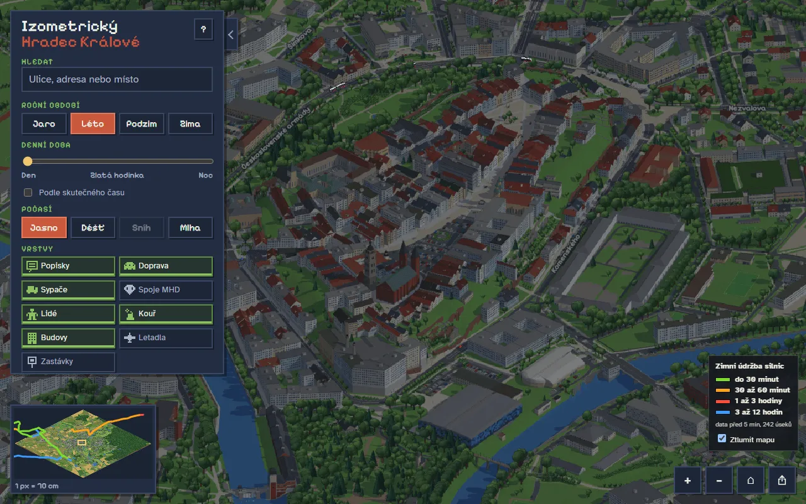
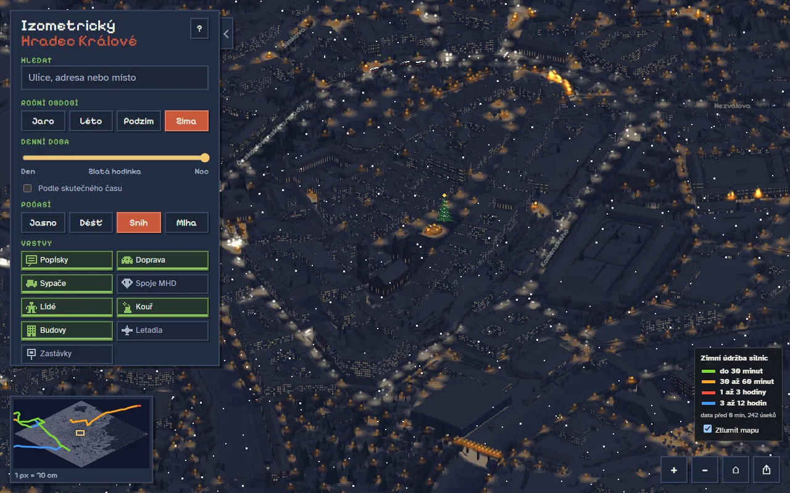
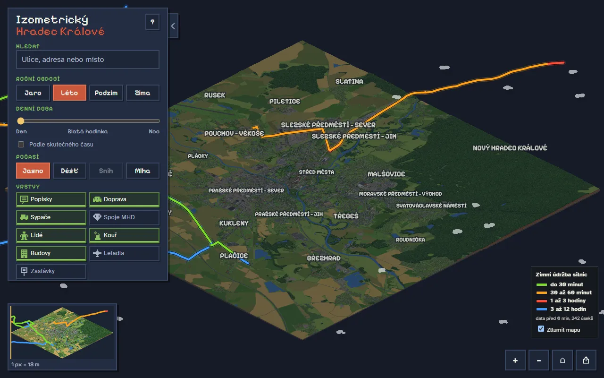
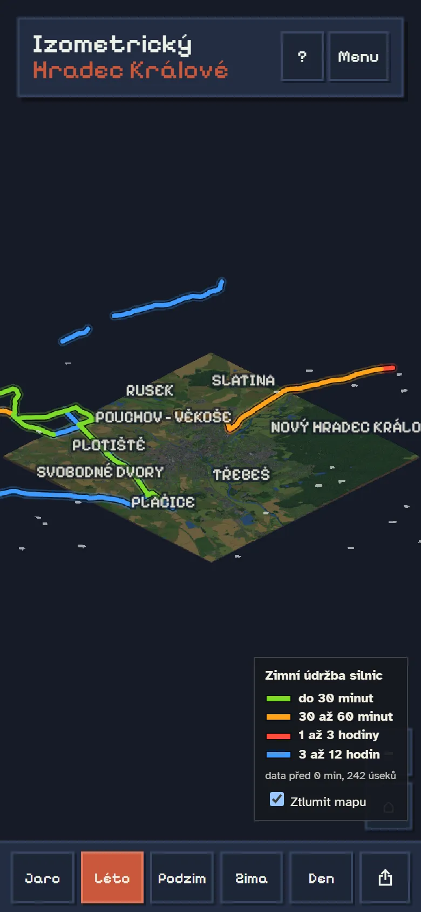

# Hradec živě — izometrický Hradec Králové

Celý Hradec Králové jako izometrická pixel-artová mapa, kterou jde přibližovat od celého města až po jednotlivé domy. Na mapě se dá přepínat roční období, denní doba a počasí. Nad mapou běží živá data: MHD, vlaky, doprava, letadla a zimní údržba silnic.

**▶ Živě: [hradeczive.vercel.app](https://hradeczive.vercel.app)**



| Zima, noc a sníh | Celé město | Mobil |
|---|---|---|
|  |  |  |

## Co to je

Projekt adaptuje open-source generátor [adamklatovsky/izomapa](https://github.com/adamklatovsky/izomapa) (původně pro Liberec) na Hradec Králové a rozšiřuje ho o místní data. Mapa pokrývá mřížku 5 × 5 čtverců o straně 2,3 km.

- **Vzhled:** 4 roční období a noc, počasí (déšť, sníh, mlha), popisky čtvrtí, ulic a dominant.
- **Dominanty:** vlastní 3D modely klíčových budov (Bílá věž, katedrála sv. Ducha, Gymnázium J. K. Tyla, Hučák …), ověřované proti volně licencovaným fotkám.
- **Data magistrátu:** skutečné tvary vozovek a chodníků, vodorovné značení, stromy a zeleň, lampy, opěrné zdi (z otevřených dat Magistrátu HK).
- **Živé vrstvy:** poloha a zpoždění MHD, vlaky, plynulost dopravy, letadla nad městem, zimní údržba silnic, zápasy FC Hradec Králové.
- **Hlášení chyb:** návštěvník nahlásí chybu přímo z karty místa a z hlášení se automaticky založí issue na GitHubu.

## Jak to funguje

```
OSM, Overture, ČÚZK (DMR/DMP), Magistrát HK
        │  izomapa (Python): scéna → render → DeepZoom dlaždice WebP
        ▼
Cloudflare R2 (dlaždice)  ◄──  skripty/nahrat_dlazdice_r2.mjs
        │
Vercel (web OpenSeadragon + funkce /api/*)  ◄──  skripty/pripravit_vercel.mjs
        │
živá data: /api/mhd_live, /api/doprava, /api/flights, /api/udrzba_khk, /api/zapasy, /api/report
```

Repo rozdělení:
- **Tohle repo (`hradeczive`)** obsahuje řízení projektu: skripty pro data Hradce, nasazení, Vercel funkce (`skripty/vercel_api/`), sběr dopravy přes GitHub Actions (`.github/workflows/doprava.yml`) a dokumentaci.
- **Renderer** je fork izomapy, větev `hradec`: [frenkees/izomapa](https://github.com/frenkees/izomapa/tree/hradec). Přesná použitá verze je v souboru `IZOMAPA_VERZE`.

Úpravy, které se hodí i ostatním městům, posílám zpět do upstreamu jako pull requesty.

## Stack

Python (render scén, zpracování dat) · JavaScript / Node.js (Vercel Functions, skripty nasazení) · OpenSeadragon · Cloudflare R2 · Vercel · GitHub Actions · Git Bash skripty

## Jak vzniklo s Claude Code

Projekt vzniká s Claude Code. Většina commitů má Claude jako spoluautora. Postup je vidět přímo v repu:

- [`CLAUDE.md`](CLAUDE.md) — zadání, geografické vymezení, pravidla a architektura pro Clauda,
- [`STAV_PROJEKTU.md`](STAV_PROJEKTU.md) — průběžný stav, postup stavby a nasazení, otevřené úkoly (Claude ho čte na začátku každé session),
- `PLAN_*.md`, `NAVRH_procedury_budov.md` — plány větších změn před implementací,
- [`REPORT_hlaseni.md`](REPORT_hlaseni.md) — zpracování hlášení od návštěvníků,
- `graphify-out/` — znalostní graf kódu a dokumentů, přes který Claude hledá souvislosti.

## Spuštění

Stavba celé mapy potřebuje fork izomapy (`izomapa/` jako samostatný git uvnitř tohoto repa), Python a Git Bash. Postup je popsaný v [`STAV_PROJEKTU.md`](STAV_PROJEKTU.md), sekce *Jak mapu postavit a nasadit*. Klíče (HERE, TomTom, R2, GitHub token) se do repa neukládají a čtou se z proměnných prostředí.

## Zdroje dat a atribuce

- © přispěvatelé [OpenStreetMap](https://www.openstreetmap.org/copyright) (ODbL)
- Overture Maps Foundation (budovy, místa)
- ČÚZK (digitální model reliéfu a povrchu)
- [Magistrát města Hradec Králové](https://web.mmhk.cz/opendata/) (pasport komunikací a zeleně, veřejné osvětlení, dopravní značení)
- DPMHK (jízdní řády GTFS CIS JŘ, živé polohy vozidel)
- Správa a údržba silnic Královéhradeckého kraje (zimní údržba)
- HERE a TomTom (dopravní data)
- adsb.lol (ODbL) a adsb.fi (letadla)
- FC Hradec Králové / onlajny.com (zápasy)
- Wikimedia Commons (volně licencované referenční fotky dominant, slouží jen jako předloha modelů a do repa ani na web se neukládají; viz `skripty/commons_fotky.py`)

## Licence

- Skripty a dokumentace v tomto repu: [MIT](LICENSE) © 2026 Pavel Procházka.
- Renderer [izomapa](https://github.com/adamklatovsky/izomapa) je licencovaný pod **AGPL-3.0** (autor Adam Klatovský). Upravená verze, která pohání web, je veřejně ve forku [frenkees/izomapa](https://github.com/frenkees/izomapa/tree/hradec) pod stejnou licencí.
- Na data platí licence jejich zdrojů (viz výše).
